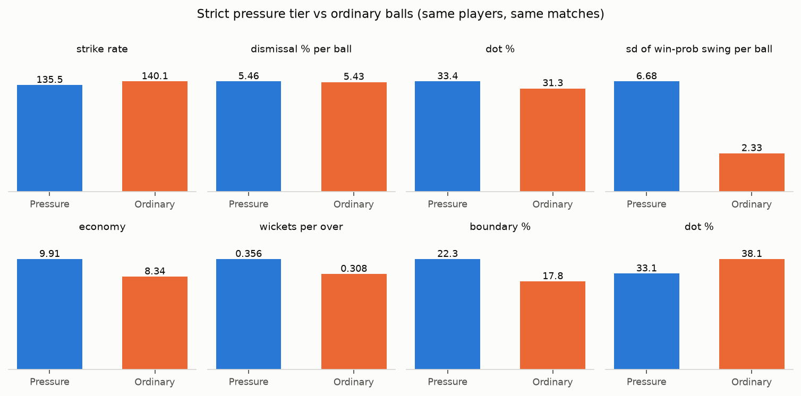
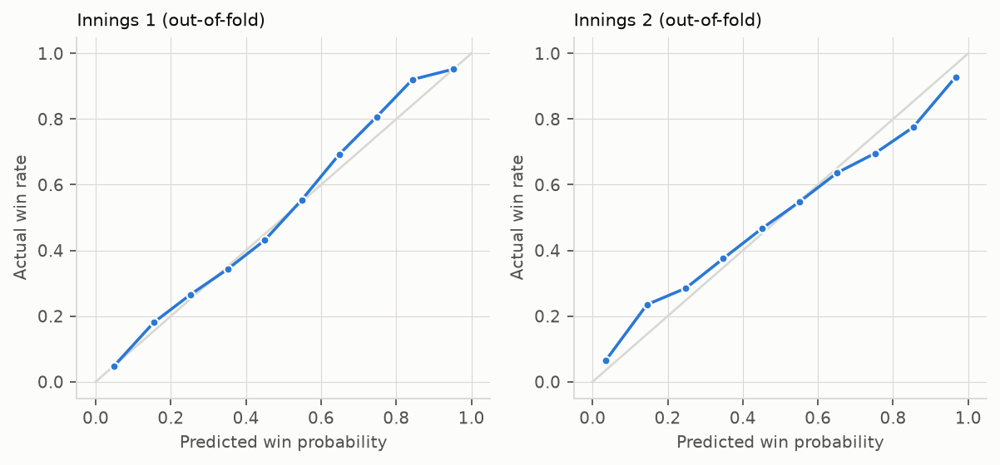
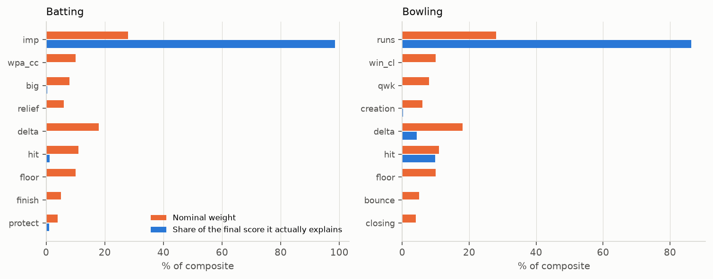
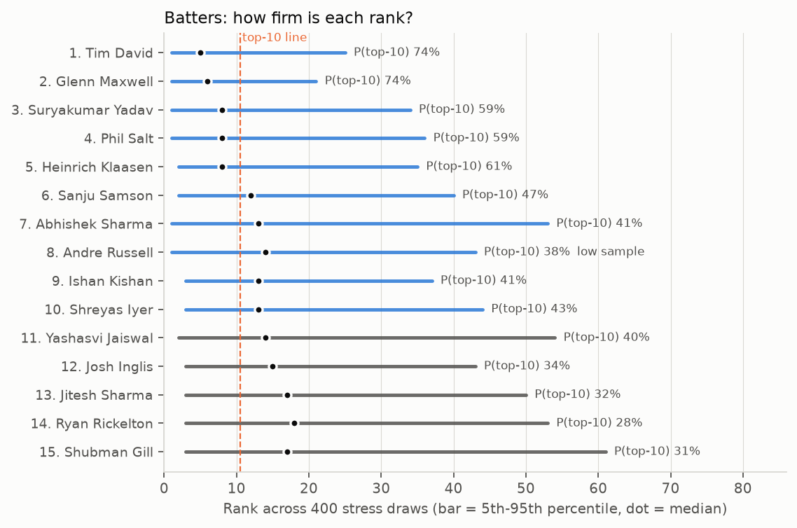
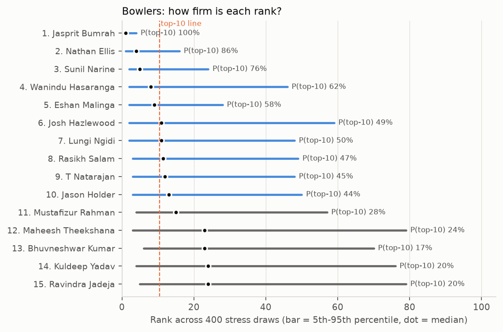
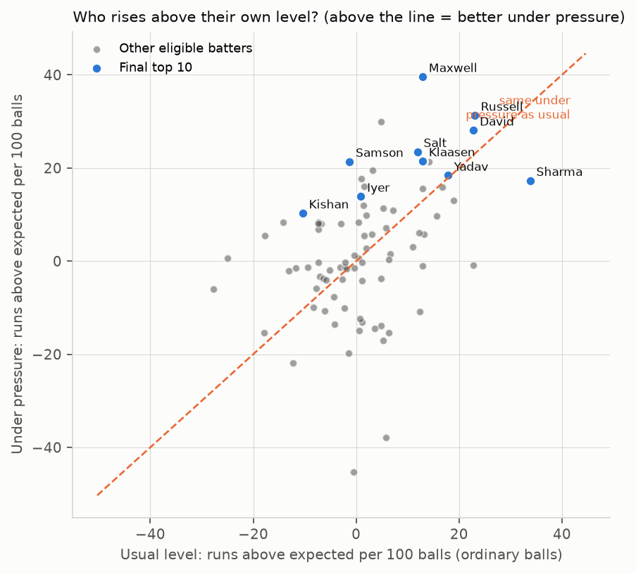

# SupeRR Selector Season 2 – Round 1: Most reliable players under pressure

Methodology report (v4). All numbers below are produced by the code in pressure_model_v4/ from the supplied CSVs only; nothing relies on reputation.

## 1. Summary of results

Final top 10 batters (rank order): 1. Tim David; 2. Glenn Maxwell; 3. Suryakumar Yadav; 4. Phil Salt; 5. Heinrich Klaasen; 6. Sanju Samson; 7. Abhishek Sharma; 8. Andre Russell; 9. Ishan Kishan; 10. Shreyas Iyer.

Final top 10 bowlers (rank order): 1. Jasprit Bumrah; 2. Nathan Ellis; 3. Sunil Narine; 4. Wanindu Hasaranga; 5. Eshan Malinga; 6. Josh Hazlewood; 7. Lungi Ngidi; 8. Rasikh Salam; 9. T Natarajan; 10. Jason Holder.

How the ranking works: every player gets a Clutch Meter (50 = the average eligible player, each 10 points = one standard deviation). It is 50 + 10 × the player’s average standardised score over 400 stress draws, in which I (a) resample the matches, (b) randomly perturb every metric weight by about ±35% and (c) switch at random between the strict and broad pressure definitions. Players are ranked strictly by Clutch Meter. The “P(top-10)” and rank range columns are confidence measures: they show how often, and how high, a player finishes across the 400 draws, and are not used to order the list.

Honest headline: the bowling ranking is reasonably firm at the top (Bumrah is top-10 in 100% of draws; held-out validity 0.17), while the batting ranking is only firm for the top handful (best P(top-10) 74%; held-out validity 0.04). Positions below the top 3–5 in each list are statistically close and should be read as a tier, not a strict order.

## 2. Data preparation

- Scope: 815 IPL and T20I matches from 2022 to 2026-11-01; 187,042 faced deliveries (batting) and 194,514 deliveries (bowling). Super-over innings and rain-affected (revised-target) matches are excluded because ball-level win probability is not comparable there.
- Missing runs: the ball-by-ball file does not record the runs on byes, leg-byes or boundary wides (the 'extras1_runs' column is a type code, not a run count). The innings totals were therefore reconciled with the result text (chase won ⇒ chaser finishes above target; bat-first win by N runs ⇒ difference equals N) and the shortfall allocated to the extras deliveries. 385 matches were adjusted this way and 10 with inconsistent data were dropped. This is a heuristic; it is the main data-quality caveat.
- Opponent strength: IPL end-of-season league table and ICC T20I team ratings (z-scored). These are season-end or year-end snapshots, so they contain some look-ahead; an Elo-style rolling rating would be cleaner.

## 3. Defining pressure

Pressure is defined once, as leverage: how much the win probability can swing on the next ball. A win-probability model (gradient boosting with monotone constraints, scored out-of-fold by match) is built from required rate, runs needed, wickets, balls left, venue-era par score, recent dot balls and a team-strength gap. Second-innings model: AUC 0.886, Brier 0.1396 vs 0.2494 for a coin-flip baseline; first-innings AUC 0.783. A second model predicts the expected absolute swing (leverage). A ball is then classed into a pressure tier:

- STRICT tier (headline, 17.2% of batting balls): top 10% of leverage (damped when the game is already decided), or a rule-based situation – last pair with 2+ overs left; rescue (4+ down inside 12 overs or 3+ down inside 6, as the underdog); early collapse (2+ wickets in 3 overs inside the first 6 overs); hard chase (target ≥ 1.15× venue par, first 8 overs, underdog).
- Bowling strict tier (20.7% of deliveries): death overs (16–20) with win chance 30–70%; the batting side scoring 26+ off the last 12 balls with the game live; a chase within 43–57% win chance; or top 10% of the bowling pressure index. The first-innings “knife-edge” rule was removed because first-innings win probability is near 50% early by construction, which made the powerplay look like a pressure phase.
- BROAD tier (32.6% of batting balls): the v3 definition (top 20% of a blended index plus extra situations), kept as one of the two definitions the final ranking averages over.

Does it distinguish pressure from ordinary play? Figure 1 and the table below compare the strict tier against ordinary balls for the same players.

*Figure 1. Strict pressure tier vs ordinary balls.*

| Measure (batters) | Pressure | Ordinary |
|---|---|---|
| share | 0.172 | 0.828 |
| strike rate | 135.5 | 140.1 |
| dismissal % per ball | 5.46 | 5.43 |
| dot % | 33.4 | 31.3 |
| boundary % | 18.3 | 18.8 |
| sd of win-prob swing per ball (x100) | 6.68 | 2.33 |
| batting-side win % | 37.0 | 51.6 |

| Measure (bowlers) | Pressure | Ordinary |
|---|---|---|
| share | 0.207 | 0.793 |
| economy | 9.91 | 8.34 |
| wickets per over | 0.356 | 0.308 |
| dot % | 33.1 | 38.1 |
| boundary % | 22.3 | 17.8 |
| wides+no-balls % | 5.04 | 3.89 |
| fielding-side win % | 44.5 | 52.6 |

- For bowlers the tier is clearly harder: economy 9.91 vs 8.34, boundaries and extras up, dots down.
- For batters the tier is defined by consequence rather than by an obvious drop in output: the win-probability swing per ball is nearly 3× larger (6.68 vs 2.33) and the batting side wins only 37.0% of the time, but dismissal rate per ball is essentially unchanged and first-innings pressure strike rate is lower (112.6 vs 143.1) while chase pressure strike rate is higher (142.8 vs 136.0). I report this plainly: pressure for a batter is mostly about stakes, and the data show only modest behavioural change.

*Figure 2. Win-probability calibration by predicted decile (out-of-fold, grouped by match). The diagonal is perfect calibration.*

## 4. Measuring performance

Every delivery has an expected outcome from models that know the batter’s slot, the partner (quality, and whether that partner is a tail-ender), bowler quality, type and speed, venue, opposition strength, target difficulty and the match state (but never the player’s own identity). Player performance is the residual: actual minus expected, so an opener, a finisher and a death bowler are each compared with the average player in that situation. Batting impact adds the cost of getting out (the change in the batter’s expected future runs), so a six followed by a dismissal is not scored as a strike rate of 300.

Each metric is an estimate with a known sampling variance (match-clustered, centred on the player’s own mean and never below the ball-level variance). DerSimonian–Laird empirical-Bayes shrinkage pulls it towards the population mean by exactly as much as its noise requires, and a metric with no repeatable between-player signal is shrunk to zero automatically. The composite is the weighted sum of the standardised, shrunk metrics.

Weights were fixed in advance from the problem statement, not fitted: validity numbers in this data (Spearman ≈ 0–0.2 on 80–130 players, standard error ≈ 0.08–0.1) cannot distinguish one weighting from another. Blocks: Level 46% (how good under pressure), Pressure delta 18% (against the player’s own ordinary level – the brief’s “compared with usual performance”), Reliability 26% (“consistently”), pressure relief/creation 6% and tail protection/clean-up 4% (credit for openers who stop pressure building and for batters/bowlers who protect or finish the tail).

### Batting metrics

| Key | Metric | Weight | Block | Effective share | Repeat (r) | Validity (r) | Why this weight |
|---|---|---|---|---|---|---|---|
| imp | Impact runs above expected, strict pressure (runs scored + cost of getting out) | 28% | Level | 98.5% | 0.02 | -0.00 | Most repeatable signal in the data; the core of "performs under pressure". |
| wpa_cc | Win probability added above expected, chases and close finishes | 10% | Level | 0.0% | 0.00 | 0.00 | Brief: "how close the contest is". Win probability itself carries little repeatable signal. |
| big | Impact vs top-4 opposition and in knock-out / must-win games | 8% | Level | 0.4% | 0.00 | -0.01 | Tests "when it matters" directly (knock-outs, top-4 opposition). |
| relief | Pressure relief: win probability added above expected in overs 1-6, non-pressure balls | 6% | Relief | 0.0% | 0.00 | -0.01 | Credit for explosive starts that stop pressure building; user-requested. |
| delta | Pressure delta: pressure impact minus own non-pressure impact | 18% | Delta | 0.0% | 0.00 | 0.00 | Brief: compare with usual levels. A difference of two noisy numbers, so kept below Level. |
| hit | Share of pressure innings with positive impact | 11% | Reliability | 1.2% | 0.00 | 0.00 | Brief: "consistently". Counted per innings, so one big score cannot carry it. |
| floor | Downside: size of the bad pressure innings | 10% | Reliability | 0.0% | 0.00 | 0.00 | Penalises the bad innings (floor). |
| finish | Chase finishing: not out in a won chase, last 4 overs, game still live | 5% | Reliability | 0.0% | -0.01 | -0.03 | Cricket test of delivering when the match is on the line. |
| protect | Strike protection with a tail-ender partner (gated on runs above expected) | 4% | Tail | 1.1% | 0.02 | 0.11 | User-requested tail protection; gated on runs above expected. |

### Bowling metrics

| Key | Metric | Weight | Block | Effective share | Repeat (r) | Validity (r) | Why this weight |
|---|---|---|---|---|---|---|---|
| runs | Runs saved vs expected, strict pressure | 28% | Level | 86.3% | 0.19 | 0.17 | Only bowling signal that repeats well; largest weight. |
| win_cl | Win probability added defending the last 2 overs and close games | 10% | Level | 0.0% | 0.00 | 0.00 | Classic test: defending the last 2 overs and close games. |
| qwk | Quality-weighted wickets above expected | 8% | Level | 0.0% | 0.00 | 0.00 | Wickets matter but raw wickets are noise; weighted by batter quality and shrunk. |
| creation | Pressure creation: win probability added above expected in overs 1-6, non-pressure balls | 6% | Relief | 0.3% | 0.00 | 0.00 | Early wickets / dots that create pressure; user-requested. |
| delta | Pressure delta: runs saved under pressure minus own non-pressure runs saved | 18% | Delta | 4.3% | 0.01 | 0.05 | Brief: compare with usual levels. |
| hit | Share of pressure spells with positive win impact | 11% | Reliability | 9.8% | 0.13 | 0.12 | Per-spell consistency. |
| floor | Downside: size of the bad pressure spells | 10% | Reliability | 0.0% | 0.00 | 0.00 | Penalises the bad spell. |
| bounce | Bounce-back: runs saved + wicket value on the ball after conceding a boundary (game live) | 5% | Reliability | 0.0% | 0.00 | 0.00 | Resilience: ball after conceding a boundary. |
| closing | Tail clean-up: win impact against batting-order 8-11 while the game is live | 4% | Tail | 0.0% | 0.00 | 0.00 | Clean-up of the tail; user-requested analogue of tail protection. |

Repeat = Spearman correlation of the metric between two random halves of the matches; Validity = correlation of the metric in one half with held-out pressure performance in the other (strict tier, 20 random splits). “Effective share” is the part of the final score’s variance the metric actually explains.

*Figure 3. Nominal weights vs the share of the final score each metric really drives.*

Important finding: the empirical-Bayes step finds no repeatable between-player signal in several of the metrics the brief asks for. In batting, about 98% of the final score comes from the impact metric; pressure delta, win-probability added, relief, downside, chase finishing and (almost) tail protection contribute close to nothing because they cannot be separated from luck with 8–40 pressure innings per player. In bowling, runs saved explains 86%, the share of positive pressure spells 10% and pressure delta 4%. The nominal weights above stay in the formula (they are what I would weight if the data allowed it), but the report does not claim that, for example, “clutch delta” is measured reliably.

## 5. Fair comparisons

- Sample size: eligibility is 60 strict-pressure balls and 8 pressure innings for batters (82 eligible) and 80 deliveries and 8 spells for bowlers (134 eligible). Because the strict tier is small, these are lower than I would like; 16 batters and 24 bowlers are flagged ‘low sample’ and shrinkage is the main protection for them.
- Batting position: expectations are slot-aware; a position check (below) tests that the pooled batting list does not systematically favour one position.
- IPL vs T20I: both are included and the model has competition-level, opposition-strength and venue terms; the stress test includes IPL-only and T20I-only re-ranks. Opponent strength comes from IPL tables and ICC ratings, which are on different scales.
- Match context: matches are weighted by importance (knock-outs and must-win games count more) and by recency (3-year half-life); both are tested by removing them.
- Pool: every player in the data with enough pressure exposure is ranked. The brief does not require current activity, so no 2026 filter is applied (the dashboard shows an activity flag).

| Batting position check | Eligible | Mean Clutch Meter (z) | In top 10 | In top 30 |
|---|---|---|---|---|
| Top order (1–3) | 29 | +0.12 | 4 | 13 |
| Middle order (4–5) | 41 | -0.11 | 4 | 13 |
| Finisher (6–11) | 12 | +0.09 | 2 | 4 |

The batting list is balanced across positions (table above). For bowlers I ran the same check internally, grouping bowlers by the share of their deliveries bowled in overs 16–20; it found that bowlers who bowl many death overs score higher on average (7 of the top 10), because their pressure overs are by construction the highest-leverage ones. Centring the score within that grouping keeps 9 of the 10 (see the sensitivity table). The grouping is used only for this check and is not shown as a label anywhere.

## 6. Evidence for the top 10

| # | Batter | Slot | Pressure balls | Pressure inns | SR (pressure) | Expected SR | Runs above exp /100 (pressure) | … (ordinary) | Clutch Meter | P(top-10) | Rank range | Flag |
|---|---|---|---|---|---|---|---|---|---|---|---|---|
| 1 | Tim David | Finisher | 256 | 17 | 175.0 | 146.9 | 28.1 | 22.8 | 68.0 | 74% | 1–25 |  |
| 2 | Glenn Maxwell | Middle order | 179 | 11 | 174.3 | 134.7 | 39.6 | 12.9 | 65.6 | 74% | 1–21 |  |
| 3 | Suryakumar Yadav | Middle order | 514 | 30 | 164.6 | 146.2 | 18.4 | 17.8 | 64.4 | 59% | 1–34 |  |
| 4 | Phil Salt | Top order | 213 | 10 | 180.8 | 157.3 | 23.5 | 11.9 | 64.3 | 59% | 1–36 |  |
| 5 | Heinrich Klaasen | Middle order | 267 | 19 | 161.4 | 139.9 | 21.5 | 12.9 | 63.7 | 61% | 2–35 |  |
| 6 | Sanju Samson | Top order | 268 | 16 | 176.5 | 155.1 | 21.4 | -1.3 | 61.6 | 47% | 2–40 |  |
| 7 | Abhishek Sharma | Top order | 319 | 22 | 170.2 | 152.9 | 17.3 | 33.8 | 61.1 | 41% | 1–53 |  |
| 8 | Andre Russell | Finisher | 131 | 8 | 157.3 | 125.9 | 31.3 | 23.0 | 60.2 | 38% | 1–43 | low sample |
| 9 | Ishan Kishan | Top order | 376 | 20 | 164.9 | 154.6 | 10.3 | -10.4 | 60.2 | 41% | 3–37 |  |
| 10 | Shreyas Iyer | Middle order | 359 | 22 | 162.7 | 148.8 | 13.9 | 0.9 | 60.1 | 43% | 3–44 |  |

*Figure 4. Rank ranges for the 15 highest-ranked batters.*

| # | Bowler | Pressure balls | Pressure spells | Econ (pressure) | Expected econ | Econ (ordinary) | Wkts | Clutch Meter | P(top-10) | Rank range | Flag |
|---|---|---|---|---|---|---|---|---|---|---|---|
| 1 | Jasprit Bumrah | 556 | 43 | 7.64 | 10.08 | 6.92 | 28 | 84.9 | 100% | 1–4 |  |
| 2 | Nathan Ellis | 346 | 24 | 8.37 | 10.17 | 8.12 | 27 | 71.5 | 86% | 1–16 |  |
| 3 | Sunil Narine | 305 | 29 | 7.34 | 9.47 | 6.64 | 13 | 68.9 | 76% | 2–24 |  |
| 4 | Wanindu Hasaranga | 317 | 26 | 7.47 | 8.86 | 7.85 | 34 | 66.5 | 62% | 2–46 |  |
| 5 | Eshan Malinga | 219 | 19 | 8.90 | 10.73 | 9.14 | 11 | 65.8 | 58% | 2–28 |  |
| 6 | Josh Hazlewood | 345 | 31 | 8.76 | 9.96 | 8.08 | 25 | 64.7 | 49% | 2–59 |  |
| 7 | Lungi Ngidi | 277 | 22 | 8.81 | 10.56 | 9.00 | 19 | 64.5 | 50% | 2–48 |  |
| 8 | Rasikh Salam | 134 | 11 | 9.12 | 10.95 | 9.50 | 9 | 63.6 | 47% | 3–49 |  |
| 9 | T Natarajan | 362 | 31 | 9.32 | 10.66 | 9.81 | 23 | 63.2 | 45% | 3–48 |  |
| 10 | Jason Holder | 541 | 43 | 9.28 | 10.47 | 8.82 | 26 | 62.9 | 44% | 3–50 |  |

*Figure 5. Rank ranges for the 15 highest-ranked bowlers.*

*Figure 6. Each batter’s level under pressure against their own ordinary level.*

Reading Figure 6: players above the dashed line do better under pressure than usual; most good batters sit near the line, i.e. they are good players rather than players who lift specifically under pressure. This is why the score is described as “performance under pressure relative to the average player in that situation”, with the player’s own baseline shown alongside it.

## 7. Reliability and limitations

| Check | Batting | Bowling |
|---|---|---|
| Held-out validity of composite, strict tier | 0.044 | 0.171 |
| Held-out validity of composite, broad tier | 0.025 | 0.142 |
| Split-half repeatability of composite (strict / broad) | 0.072 / 0.116 | 0.200 / 0.157 |
| Chronological: 2022-23 → 2024-26 (strict) | 0.014 | 0.196 |
| Chronological: 2024-26 → 2022-23 (strict) | -0.058 | 0.216 |
| Mean P(top-10) of the final 10 | 54% | 62% |
| Players with P(top-10) ≥ 80% | 0 | 2 |

Sensitivity of the final top 10 (number of the final 10 recovered by each variant):

| Batting variant | Overlap | Eligible in variant |
|---|---|---|
| Position-standardised (score centred within batting position) | 8 / 10 | 82 |
| Strict tier only (~17% of balls) | 7 / 10 | 82 |
| Broad tier only (v3 definition, ~33% of balls) | 8 / 10 | 82 |
| No match-importance weighting | 9 / 10 | 82 |
| No recency weighting | 7 / 10 | 82 |
| Equal weights over the 9 metrics | 8 / 10 | 82 |
| Level metrics only (no Delta / Reliability / extras) | 7 / 10 | 82 |
| Without Delta | 7 / 10 | 82 |
| Without Relief and Tail extras | 7 / 10 | 82 |
| IPL matches only | 6 / 10 | 82 |
| T20I / other matches only | 1 / 10 | 71 |

| Bowling variant | Overlap | Eligible in variant |
|---|---|---|
| Standardised within groups of bowlers by share of overs bowled at the death | 9 / 10 | 134 |
| Strict tier only (~17% of balls) | 10 / 10 | 134 |
| Broad tier only (v3 definition, ~33% of balls) | 9 / 10 | 134 |
| No match-importance weighting | 9 / 10 | 134 |
| No recency weighting | 10 / 10 | 134 |
| Equal weights over the 9 metrics | 9 / 10 | 134 |
| Level metrics only (no Delta / Reliability / extras) | 10 / 10 | 134 |
| Without Delta | 10 / 10 | 134 |
| Without Relief and Tail extras | 10 / 10 | 134 |
| IPL matches only | 7 / 10 | 104 |
| T20I / other matches only | 2 / 10 | 114 |

- Batting is a weak-signal problem. Validity of 0.03–0.04 means the ordering mostly reflects luck beyond the top few; only the tier (strong middle-order/finisher/opener hitters) is dependable. Of the 10 ranked, the best has a P(top-10) of 74% and several are flagged low-sample.
- The result depends on the data window: re-ranking on T20I matches only recovers just 1 of 10 batters and 2 of 10 bowlers (T20I samples are small, so this is partly noise), and IPL-only recovers 6 / 7. The final list is effectively an IPL-weighted view.
- The pressure definition matters: the strict-only and broad-only top 10s each recover 7–8 batters and 9–10 bowlers; averaging both is the compromise.
- Run reconstruction, season-end team ratings and absence of pitch/dew information are known data limitations. Bye/leg-bye runs are allocated, not observed.
- Because the weights are fixed rather than fitted, they reflect my judgement of the brief; the effective-share chart shows how little of that judgement the data can currently confirm.

## 8. Reproducing the results

- Environment: Python 3.12 with numpy, pandas, scikit-learn, scipy (see requirements.txt).
- python m1_features.py - .. stage1.pkl  →  python m2_expect.py - stage1.pkl stage2.pkl ..  →  python b1_bowling_expect.py - stage2.pkl bstage.pkl ..
- python v4_rate.py - bat stage2.pkl .. batters_v4.json  and  python v4_rate.py - bowl bstage.pkl .. bowlers_v4.json   (BR=400 draws; seeds fixed)
- python make_report.py   and   python build_dashboard_v4.py
